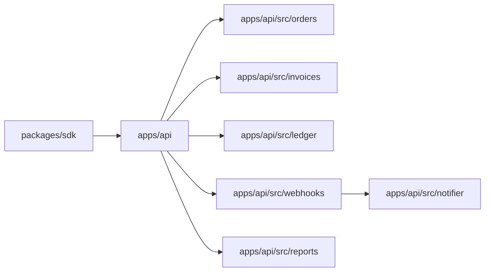

# Architecture

Tallyhook is one NestJS service, `apps/api`, run as two processes (the HTTP API and the queue
worker) over Postgres, Redis and S3.



## Jobs

The nightly `ReportsDigestProcessor` builds the previous day's totals per currency; the
`reports-daily` CronJob schedules it at 02:15 UTC. Webhook deliveries run on the
`webhook-deliveries` queue, handled by the worker process.

## Data

Orders, invoices and ledger entries live in Postgres. Invoice PDFs live in S3 under
`invoices/<id>.pdf`. Redis holds the queues and the shared rate-limit counters.

## Delivery

A webhook delivery is attempted, then retried with exponential backoff and jitter, and parked
after the last attempt:

```pseudo
attempt = 0
while attempt < limit:
    send(delivery); stop on a 2xx answer
    wait(backoff(attempt)); attempt = attempt + 1
park(delivery)
```

The SDK gives up after `MAX_RETRIES` attempts on idempotent requests.
